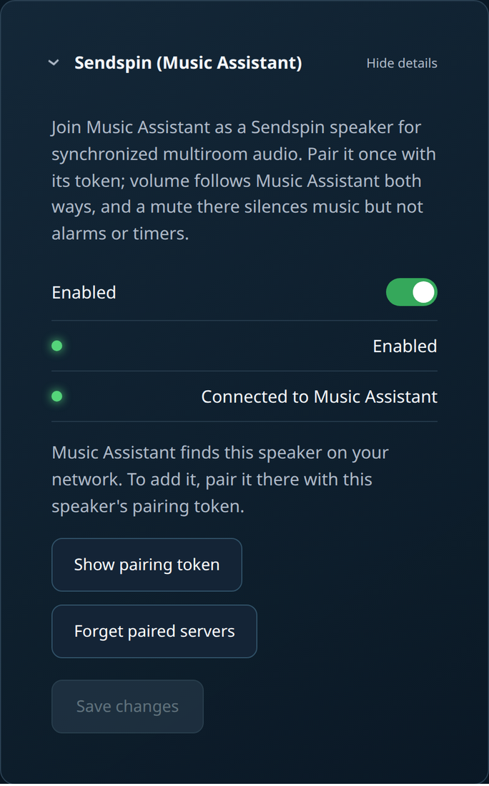
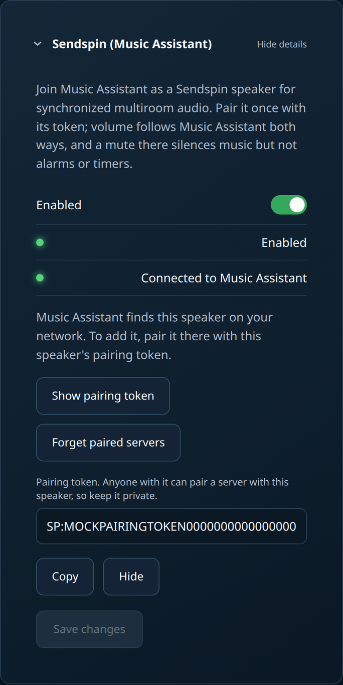

# Sendspin: multiroom audio with Music Assistant

> **Draft for 0.15.** Tested on an Echo (2nd generation) and an Echo Dot
> with Music Assistant 2.10.8: discovery, token pairing, grouping, play,
> pause, seek, leave/rejoin, volume and mute. Screenshots will be added
> before 0.15 ships.

LibreEcho can join [Music Assistant](https://music-assistant.io/) as a
Sendspin speaker. Music Assistant then plays to it on its own or in a group
with other Sendspin speakers, kept in time with each other.

## What you need

- LibreEcho 0.15 or later on an Echo (2nd generation) or Echo Dot. The
  player ships in the audio feature; the integration card says *Not
  installed in this image* when it is missing.
- Music Assistant on the same local network as the speaker. Discovery uses
  mDNS (`_sendspin._tcp`), so multicast must pass between them; Wi-Fi
  "client isolation" or separate VLANs without an mDNS reflector stop it.
- The speaker accepts Sendspin connections on TCP port 8928.

## Turn it on

1. Open the speaker's web page and go to **Integrations**.
2. Tick **Sendspin (Music Assistant)** and press **Save**. It is off by
   default.
3. The card shows the player state:

   | Card says | Meaning |
   |---|---|
   | Starting the player… | Enabled, the player is starting. |
   | Waiting for Music Assistant. This speaker is discoverable on your network. | Ready and advertised; no server connected yet. |
   | Connected to *server* (not paired yet) | A server connected but has no stored pairing. |
   | Connected to *server* | Paired and connected. |
   | Playing from *server* | Audio is playing. |
   | Not configured | The integration is off. |

   

## Pair it with Music Assistant

The speaker only plays for a server it is paired with.

1. On the Sendspin card press **Show pairing token**, then **Copy**. The
   token starts with `SP:`. Anyone who has it can pair a server with this
   speaker, so keep it private; press **Hide** when you are done. The token
   is never shown in status, logs or a configuration export.

   
2. In Music Assistant the speaker appears under its host name, marked as
   needing setup. Open it, start the setup, and paste the token when Music
   Assistant asks for the pairing token.
3. The card changes to *Connected to …*. Pairing is stored on the speaker
   and survives restarts.

## Using it

- **Groups.** Create a group of Sendspin players in Music Assistant. Each
  LibreEcho speaker corrects for its own output delay (including its speaker
  processing), so grouped speakers play together: an Echo (2nd generation)
  and an Echo Dot side by side measured within 0.05 ms of each other.
- **Starting.** Playback starts about 1.5 seconds after you press play,
  mostly while the speaker's amplifier powers up.
- **Volume.** Sendspin volume *is* the speaker volume. A change in Music
  Assistant moves the speaker volume like the volume buttons, and the
  buttons, web page or AirPlay volume are reported back to Music Assistant.
- **Mute.** Muting the speaker in Music Assistant silences Sendspin music
  only. Alarms, timers and voice replies still play.
- **Alarms.** An alarm takes over the speaker while it sounds; Sendspin
  audio is silenced for that time.

## Limits

- Audio format: FLAC (preferred, lossless at about half the Wi-Fi bit rate)
  or uncompressed PCM, both 48 kHz 16-bit stereo; Music Assistant resamples
  other sources. Opus is not supported.
- One server at a time.

## Forget paired servers

On the Sendspin card press **Forget paired servers** and confirm. The
speaker forgets every server it was paired with and gets a new pairing
token; each server has to pair again with the new token. Use it when you
replace your Music Assistant server or if the token may have leaked. It
also works while the integration is off.

## Turn it off

After **Forget paired servers**, Music Assistant still lists the speaker but
can no longer connect; set it up again with the new token, or remove it in
Music Assistant.

Untick **Sendspin (Music Assistant)** on the Integrations page and press
**Save**. The player stops and is no longer advertised on the network.
Its pairing is kept; use **Forget paired servers** to remove it.

## Troubleshooting

- **Music Assistant does not find the speaker.** Check that the card says
  *Waiting for Music Assistant*, that both are on the same network, and
  that multicast/mDNS is allowed between them (see *What you need*).
- **The card stays on *Starting the player…*.** The audio feature may still
  be starting after boot; wait a minute. If it stays, download a diagnostic
  bundle from the System page and include it in a bug report.
- **Connected but no sound.** Check the speaker volume and that it is not
  muted in Music Assistant, and that no alarm is sounding.

For developers: the REST endpoints are `GET /api/v1/sendspin`,
`POST /api/v1/sendspin/pairing`, `POST /api/v1/sendspin/unpair` and
`PUT /api/v1/integrations/sendspin`
(see the UI repository's `docs/API.md`); the design is in
[`docs/architecture/sendspin.md`](../architecture/sendspin.md).
