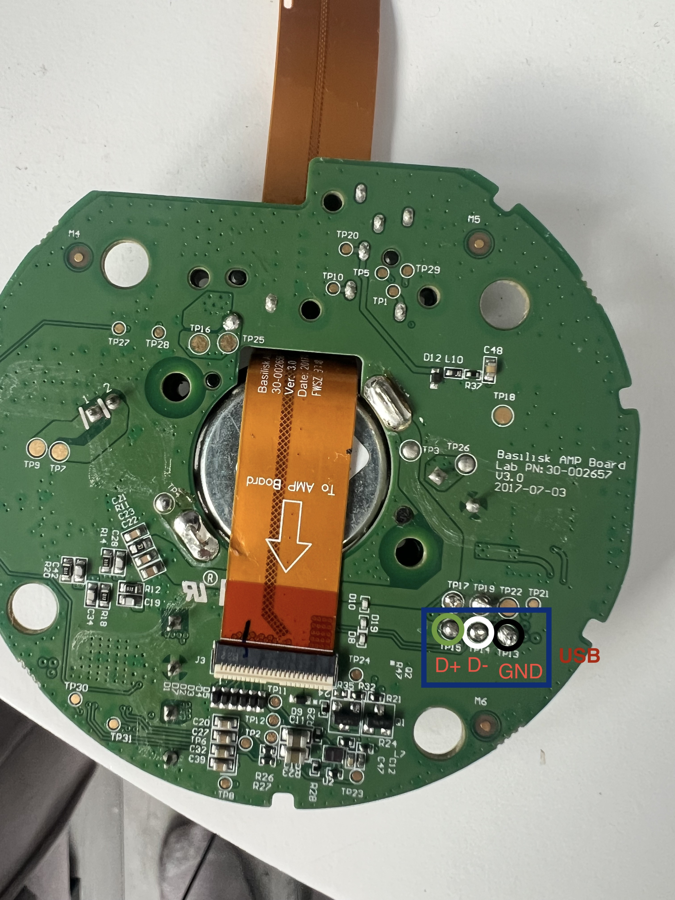

# LibreEcho installation guide

> For Amazon Echo 2nd generation (`radar_puffin`, MT8163) and Echo Dot 2nd
> generation (`biscuit`). The procedure uses USB fastboot on the stock device.
> **No shorting is needed.** On the Echo 2nd Gen you only need to reach the USB
> pins on the bottom of the device and enter fastboot. The Echo Dot 2nd Gen
> connects through its own micro-USB port and enters fastboot the same way.
> Which button you hold while plugging in depends on the bootloader: **Action**
> on a stock device, **Volume Down (−)** on a device that is already unlocked
> (Kaeru). See [Which button to hold](#which-button-to-hold).

## Safety first

- Unplug the Echo's power adapter before you connect, move, or remove the USB
  pins, and before opening anything. Never probe a powered board.
- Do not short any pad or component. The installer does not need it.
- Keep the USB connection on the approved data cable. Do not connect a TTL UART
  adapter to the USB pads.
- Use a data-capable USB cable and a direct port without a hub.
- Stop and keep the installer log if the device behaves unexpectedly.

## Supported targets

| Device | Target | Amonet archive | Accepted LK build |
|---|---|---|---|
| Echo 2nd Gen | `radar_puffin` | `amonet-radar-v1.0.0.zip` | `59779ca-20220524_183401`, `63cb91b-20221007_072309`, `63cb91b-20221007_073612` |
| Echo Dot 2nd Gen | `biscuit` | `amonet-biscuit-v2.0.0.zip` | Any; `63cb91b-20221007_072309` uses its reviewed payload, other builds the default `fastbrick.img` |

Biscuit accepts any LK build the device reports. The reviewed build
`63cb91b-20221007_072309` uses its own payload; any other build uses the
archive's default `fastbrick.img`. If the device reports no LK build (an empty
`lk_build_desc`), the installer stops before any write. The Echo 2nd Gen
accepts only the builds listed in its row.

## Equipment

### Required

- Data-capable USB cable
- **Echo 2nd Gen only:** a way to reach the USB pins on the bottom — a pogo-pin
  adapter, or a USB cable soldered to the pads (see
  [Connect the device](#2-connect-the-device))
- `adb` and `fastboot` (Debian/Ubuntu packages: `adb` and `fastboot`)
- `bash`, `curl`, and Python 3
- `mke2fs` and `dumpe2fs` (both from `e2fsprogs`)
- The published **initial-install bundle** for the target and its matching
  SHA-256 file
- **Only if the device is locked:** the pinned Amonet ZIP for your target (see
  [Run the installer](#3-run-the-installer)). LibreEcho does not redistribute it.

On Debian/Ubuntu, install the host tools before starting the installer:

```sh
sudo apt-get update
sudo apt-get install adb fastboot e2fsprogs
```

`--install-host-deps` can install only the filesystem-image helpers; it does
**not** install `adb` or `fastboot`. Confirm they are available with
`command -v adb fastboot mke2fs dumpe2fs`.

## Already running LibreEcho?

- **0.14.x:** you do not need this guide. Update over the air from the web UI:
  **System › System update › Check for updates**, then **Install update**, then
  **Reboot**.
- **0.13.x:** reinstall with this guide. The 0.13 updater cannot install the
  signed OTA v3 packages that 0.14 uses, so update checks report
  `downloaded_package_invalid` and the device stays on 0.13. The installer
  formats userdata: settings, Wi-Fi credentials, accounts and pairings are not
  kept, and you run setup again after the first boot. From 0.14 on, updates
  install from the web UI.
- **Echo 2nd Gen on the old boot chain:** if `fastboot getvar product` reports
  `BISCUIT` on an Echo 2nd Gen, or the installer fails with
  `boot_a_x readback hash mismatch`, run the
  [Kaeru migration](#echo-2nd-gen-on-the-old-boot-chain-kaeru-migration) first.
- **A previous install that did not finish:** see
  [Reinstalling over an existing installation](#reinstalling-over-an-existing-installation).

## 1. Download and verify the release

Copy and paste these commands. `latest` resolves to the current published stable
release, and the wrapper verifies and runs the immutable installer:

```sh
TAG=latest
curl -fL -o run-one-shot.sh "https://raw.githubusercontent.com/aslater3/LibreEcho/main/tools/run-one-shot.sh"
chmod +x run-one-shot.sh
```

To deliberately install a development or nightly build, replace `latest` with
that build's complete immutable `radar-puffin-build-*` or
`radar-puffin-nightly-*` tag. Use these only on maintainer-controlled test
hardware.

The wrapper resolves `latest` through GitHub's public release API, rejects draft
and prerelease results, and passes the resolved immutable tag to the installer.
It verifies the installer checksum using public GitHub download URLs and does
not require a GitHub account or token. Do not rename or mix asset files from
another release.

## 2. Connect the device

### Echo 2nd Gen (`radar_puffin`)

The Echo 2nd Gen has no external USB port. The installer reaches it through the
USB pins on the bottom of the device, then works over fastboot. Nothing needs
to be shorted.

**Reach the USB pins.** Choose one method:

- **Pogo pins (no soldering).** Remove only the outer cover on the base to
  expose the 2 × 3 gold contacts. You do not need to take the device apart.
  Seat the pogo-pin adapter on the contacts. A ready-made LibreEcho pogo-pin
  adapter will be on sale soon. Until then, a printable carrier is in
  [`tools/libreecho-echo-gen2-pogo-plug-v5.zip`](../../tools/libreecho-echo-gen2-pogo-plug-v5.zip);
  see the [tools README](../../tools/README.md#echo-gen-2-pogo-pin-carrier-v5).
- **Soldered USB cable.** Follow the
  [Echo Gen 2 disassembly guide](../disassembly/echo-gen-2/README.md) and solder
  a USB cable to the AMP-board pads TP15 (D+), TP14 (D−) and TP13 (GND):

  

  Connect only D+, D− and GND. Leave the cable's 5 V wire unconnected; the Echo
  runs from its own power adapter.

**Enter fastboot.**

1. Unplug the Echo's power adapter.
2. Connect the USB pins to the computer.
3. Press and hold the fastboot button for your device (see
   [Which button to hold](#which-button-to-hold)) and plug the power adapter in
   while still holding it: **Action** on a stock Echo, **Volume Down (−)** on
   an Echo that has already been unlocked.
4. Check that the computer sees the device in fastboot:

   ```sh
   fastboot devices
   fastboot getvar product
   ```

   Release the button once the device is listed. `product` should report
   `RADAR`. If nothing is listed, unplug the power, check the pins, and repeat
   the sequence with the other button.

### Echo Dot 2nd Gen (`biscuit`, experimental)

The Dot does not need to be opened. Its micro-USB port carries both power and
data, so one data-capable micro-USB cable to the computer is all you need.
Nothing needs to be shorted.

**Enter fastboot.**

1. Unplug the Dot's micro-USB cable.
2. Press and hold the fastboot button for your device (see
   [Which button to hold](#which-button-to-hold)) and plug the micro-USB cable
   from the computer in while still holding it: **Action** on a stock Dot,
   **Volume Down (−)** on a Dot that has already been unlocked.
3. Check that the computer sees the device in fastboot:

   ```sh
   fastboot devices
   fastboot getvar product
   ```

   Release the button once the device is listed. `product` should report
   `BISCUIT`. If nothing is listed, unplug the cable, try another data-capable
   cable or a USB port directly on the computer, and repeat the sequence with
   the other button.

A Dot that already runs LibreEcho can also start from ADB (`adb devices`); the
installer moves it to fastboot itself.

### Which button to hold

The button that opens fastboot depends on which bootloader the device has.

| Device state | Hold while powering on | Result |
|---|---|---|
| Stock (never unlocked) | **Action** | Fastboot |
| Unlocked with Kaeru (any device that has run LibreEcho, including every 0.13 → 0.14 reinstall) | **Volume Down (−)** only | Fastboot |
| Unlocked with Kaeru | **Volume Up (+)** only | Recovery |
| Unlocked with Kaeru | Volume Up and Volume Down together | Normal boot (ignored) |

On an unlocked device, holding **Action** does nothing and the Echo boots
normally. Hold **only** Volume Down; holding both volume buttons cancels the
request. If you are unsure which state the device is in, try Volume Down first,
then Action.

Once the device is listed, `fastboot oem kaeru-version` answers on an unlocked
device and fails on a stock one, and `fastboot getvar boot-reason` reports
`Volume Keys` when the button was what selected fastboot.

### Both models

The installer reads the device's fastboot product to confirm the target.

**Only if the device is locked**, download the matching Amonet ZIP and keep it
unmodified. The installer checks its size and SHA-256, and extracts only the
payload for the device's LK build.

### Echo 2nd Gen on the old boot chain (Kaeru migration)

Some Echo 2nd Gen units installed with early LibreEcho tools still run the old
biscuit/k32 boot chain, or run the current Kaeru chain on the old `_x`
partition layout. The installer cannot convert them by itself. Signs:

- `fastboot getvar product` reports `BISCUIT` on an Echo 2nd Gen, and the
  installer warns `boot-chain identity differs from board`;
- the installer fails with `boot_a_x readback hash mismatch`;
- `adb shell grep PARTNAME /sys/class/block/mmcblk0p10/uevent` shows
  `boot_a_x`.

Use the migration kit in
[`tools/radar-kaeru-migration`](../../tools/radar-kaeru-migration/README.md),
with LibreEcho running and ADB connected. Always run `--dry-run` first: it
checks the device and saves backups without writing anything.

```sh
./migrate.sh -s SERIAL --dry-run   # checks + backups, no writes
./migrate.sh -s SERIAL             # converts the boot chain and partition table
./migrate.sh -s SERIAL --verify    # reboots to fastboot, expects product=RADAR
```

If an older copy of the kit already moved the unit to Kaeru but left the `_x`
partition table, convert only the table, then reinstall:

```sh
./migrate.sh -s SERIAL --gpt-fix --dry-run
./migrate.sh -s SERIAL --gpt-fix
adb -s SERIAL reboot
./run-one-shot.sh "$TAG" --reinstall --execute-hardware
```

The kit refuses anything outside the documented Echo 2nd Gen layout. Every run
writes a log under `logs/` and a `migration.jsonl`; share both if something goes
wrong. Echo Dot 2nd Gen units and Echo 2nd Gen units already on the plain
Kaeru layout do not need the kit.

## 3. Run the installer

```sh
./run-one-shot.sh "$TAG" --fastboot-serial auto --slots both --execute-hardware
```

If the device is locked, add the Amonet ZIP:

```sh
./run-one-shot.sh "$TAG" --amonet-zip ~/Downloads/amonet-biscuit-v2.0.0.zip \
  --fastboot-serial auto --slots both --execute-hardware
```

The installer:

1. Verifies the release and the installer checksum.
2. Reads the fastboot product and checks it against the release target.
3. If the bootloader is unlocked, skips the unlock step. If it is locked,
   selects the payload for the device's `lk_build_desc` (on the Echo Dot, the
   default payload when the build has no reviewed mapping), verifies it, and
   sends it with `fastboot flash brick`.
4. Formats userdata, flashes both verified boot slots, reboots, and waits for
   ADB.
5. Verifies boot readback, stages the feature payloads, and creates the
   temporary setup forward.

`--slots both` is intentional: it writes and verifies both boot slots. Do not
substitute a raw boot image, OTA archive, or manually selected partition.

The installer does not erase `expdb`. The Kaeru unlock proof there is left
intact.

Never run the installer on a device whose product does not match the release
target. Use the device's own fastboot product; do not pass `--target` to
override a mismatch.

## 4. Watch the output

Keep the terminal open. The installer prints each stage and writes a log to
`./libreecho-installer.log`. If a stage fails, do not retry with a different
image or partition until you understand the error. Preserve the log and the exact
error text.

## Recovering from a forwarding failure

Do not restart the fresh `one-shot` flow after boot slots have been written.
Set `TAG` to the exact resolved tag from the original log (not `latest`), and
`SERIAL` to that device's original serial. Keep the original cache and state
roots, install ID, and slot selection. For example, after all payloads were
staged but local port 18080 was unavailable:

```sh
./run-one-shot.sh "$TAG" --continue --fastboot-serial "$SERIAL" \
  --slots both --local-port 18081 --execute-hardware
```

Continuation from `FEATURES_STAGED` or `WEBUI_FORWARDED` verifies the cached
inputs, boot-slot readback, and all installed payloads and manifests before
forwarding. It performs no format, flash, reboot, or payload replacement in
those states. Open the URL printed by the successful continuation. A missing
device, changed hash, or incomplete staging marker stops the operation rather
than guessing. Keep the failure log; never edit phase or format markers to
bypass a refusal.

## Reinstalling over an existing installation

`--continue` only resumes the release recorded in the saved state. To install
again — for example after a failed first install was fixed in a newer release
(LibreEcho #257), or to start over — use `--reinstall`:

```sh
./run-one-shot.sh "$TAG" --reinstall --execute-hardware
```

`--reinstall` **erases userdata** (settings, Wi-Fi, setup, installed features)
and rewrites both boot slots. It asks you to type `ERASE` first (`--yes` skips
the prompt for scripted runs). It:

- reads the target from the saved state, and moves a device running LibreEcho
  into fastboot over ADB itself, so no button sequence is needed;
- only runs on a device that is already unlocked, and never sends the brick or
  repeats the unlock;
- refuses a device other than the one bound to the install ID, and refuses
  state with an unresolved brick step (`continue-one-shot` resolves those);
- keeps the old state as `state.json.before-reinstall-<time>` next to the new
  one instead of deleting it.

## 5. First boot and setup

1. The installer has rebooted the device and waited for ADB. Do not touch the
   device or reconnect cables while it is powered.
2. Verify the temporary ADB connection and forward:

   ```sh
   adb wait-for-device
   adb get-state
   adb forward --list | grep 'tcp:18080'
   ```

3. Before Wi-Fi setup, open the installer's forwarded setup page:

   ```text
   http://127.0.0.1:18080/setup.html
   ```

   If the browser did not open automatically, enter that URL manually while the
   USB forward is active.

   If setup asks you to reboot, for example after **Accept device firmware**
   when it reports *Unrecognised Wi-Fi firmware detected*, use the setup
   page's **Reboot now** button or run `adb reboot`. The USB forward lives on
   your computer and is lost when the Echo restarts. Keep the installer window
   open: it stays attached until setup is finished, waits for the same Echo to
   come back, restores the forward, and reopens the setup page by itself.

   If you already closed the installer, reconnect with the same command you
   installed with, using `reconnect` instead of `one-shot`:

   ```sh
   python3 "libreecho-${TAG}-installer.py" reconnect
   ```

   Or restore the forward by hand (add `-s <serial>` from `adb devices -l` to
   both commands if more than one Android device is connected):

   ```sh
   adb wait-for-device
   adb forward tcp:18080 tcp:8080
   ```

   Then open `http://127.0.0.1:18080/setup.html` again. If the board does not
   come back within a few minutes, disconnect and reconnect power without
   touching any cable, then reconnect as above.
4. Complete the account and setup wizard. After Wi-Fi is applied, disconnect
   power before reconnecting any cables. Reconnect only while unpowered, then
   power on again.
5. On the normal LAN, open the advertised control-centre address:

   ```text
   http://libreecho.local:8080/
   ```

   If mDNS is unavailable, use the IP address assigned by your router:
   `http://<device-ip>:8080/`.
6. Verify that `libreecho.local` resolves and that the control centre remains
   reachable after reconnecting to the normal LAN.
7. Test the features listed for the release.

The first-run setup creates the local administrator account and stores Wi-Fi
credentials on the device. The installer does not invent, print, or upload those
credentials. A factory reset later removes the account, setup marker, Wi-Fi
profiles, and other mutable configuration, then reboots to this first-run state.

## Troubleshooting

### The device is not detected

- Confirm the USB cable is data-capable and connected directly, not through a
  hub.
- Run `adb devices` and `fastboot devices`. If neither shows the device, try
  another cable or port.
- Echo 2nd Gen: unplug the power adapter, re-seat the pogo pins (or check the
  soldered D+, D− and GND joints), then repeat the **Enter fastboot** sequence
  under [Connect the device](#2-connect-the-device). Do not short anything to
  force a different boot mode.
- A device that has already run LibreEcho ignores the **Action** button at
  power-on. Hold **Volume Down (−)** on its own instead; see
  [Which button to hold](#which-button-to-hold).

### The product does not match the release

The installer refuses to write when the device's fastboot product does not match
the release target. Do not force it with `--target`. Confirm that you are using
the bundle for this device.

An Echo 2nd Gen that reports `BISCUIT` is on the old boot chain; see
[Kaeru migration](#echo-2nd-gen-on-the-old-boot-chain-kaeru-migration).

### `boot_a_x readback hash mismatch`

The unit runs the Kaeru boot chain on the old `_x` partition table. Run the
migration kit with `--gpt-fix`, then reinstall; see
[Kaeru migration](#echo-2nd-gen-on-the-old-boot-chain-kaeru-migration).

### The device is locked and no Amonet ZIP was provided

Pass the pinned archive with `--amonet-zip`. The installer requires it only when
`unlock_status` is not `true`.

### The Amonet ZIP is refused

The archive's SHA-256 or size does not match the pin, the device reported an
empty `lk_build_desc`, or, on the Echo 2nd Gen, its LK build is not one of the
builds listed for `radar_puffin`. Use the exact archive named in the table
above. The Echo Dot accepts any non-empty LK build; the default payload covers
builds without a reviewed mapping.

### The brick step reports `eMMC-RO` or `Device mismatch`

These are hard stops. The installer does not retry them. Preserve the log and the
exact error text, and do not try another payload.

### Installer reports a write failure

Stop and note the error message. Do not try a different partition or image. Ask
for help with the release version, board revision, and error message.
