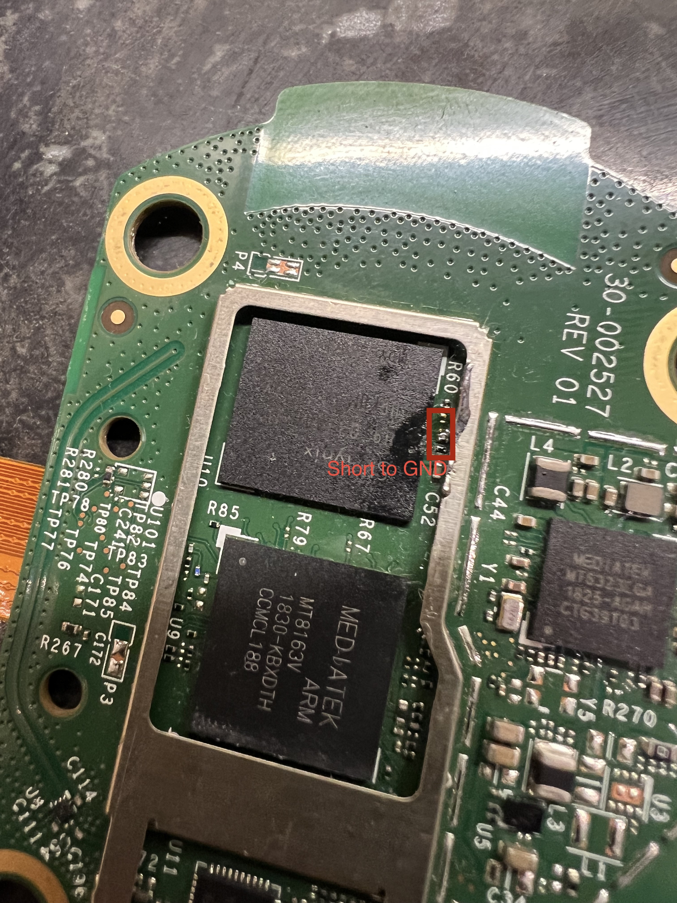
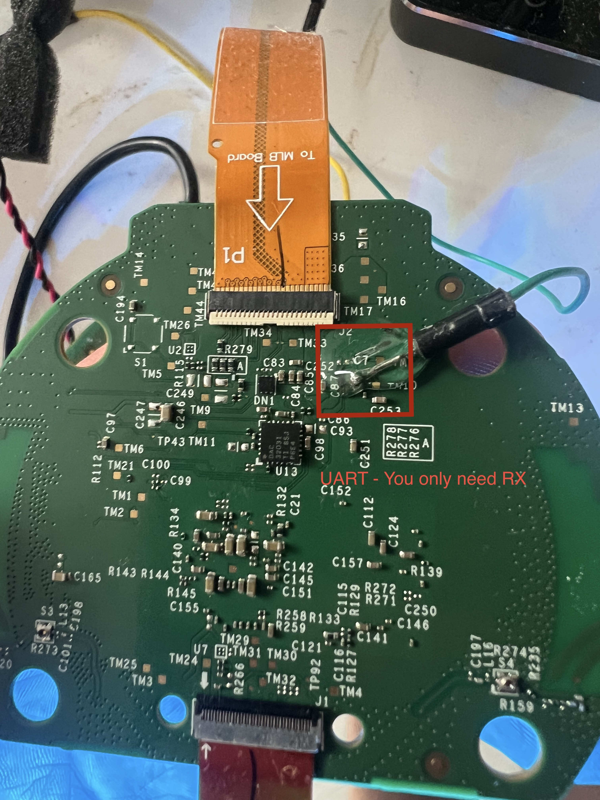

# LibreEcho installation guide

> For Amazon Echo 2nd generation (`radar_puffin`, MT8163). This procedure
> involves opening the device, soldering, exposed electronics, and entering
> MediaTek BROM mode.

> **Already running LibreEcho 0.13?** You do not need to reinstall to move to
> 0.14. See [Upgrading from 0.13 to 0.14](#upgrading-from-013-to-014).

## Safety first

- Unplug the Echo before opening it. Never solder or probe a powered board.
- The eMMC and BROM short point are underneath the heat spreader. Remove it
  carefully and protect the thermal pad.
- Use an insulated probe or purpose-built pogo jig for the short.
- Never short the UART point, USB `D+`/`D-`, a capacitor, inductor, crystal,
  battery contact, or another test pad.

## Equipment

### Required

- Data-capable USB cable
- `adb` and `fastboot` (Debian/Ubuntu packages: `adb` and `fastboot`)
- `bash`, `curl`, and Python 3
- `mke2fs` and `dumpe2fs` (both from `e2fsprogs`)

On Debian/Ubuntu, install the host tools before starting the installer:

```sh
sudo apt-get update
sudo apt-get install adb fastboot e2fsprogs
```

The installer can offer to install only the filesystem-image helpers with
`--install-host-deps`; it does **not** install `adb` or `fastboot`. Confirm they
are available with `command -v adb fastboot mke2fs dumpe2fs`.

- Fine-tip temperature-controlled soldering iron
- Fine solder, flux, 30–34 AWG wire, and Kapton tape
- Fine-point pogo pins and a stable pogo-pin jig, if not soldering
- Fine tweezers, plastic spudger, and small screwdrivers
- Magnification and good lighting
- ESD mat/wrist strap or static-safe work surface
- Digital multimeter with continuity mode
- Latest **initial-install bundle** and matching SHA-256 file
- Insulated probe or purpose-built pogo jig for the BROM short

### Optional: developer UART console

UART is **not required to install or flash LibreEcho**. USB is the required
connection for installation. Developers may add UART to watch boot messages or
debug hardware:

- 3.3 V USB-to-TTL serial adapter, adjustable to 921600 baud
- Fine-point pogo pins and a stable pogo-pin jig, or 30–34 AWG wire

Never connect a 5 V UART adapter. For the optional console, connect the board's
UART signal to the adapter's **RX input** and board ground to adapter GND. Leave
adapter TX and VCC disconnected.

## 1. Download and verify the release

LibreEcho stable releases use immutable tags in the form
`radar-puffin-vX.Y.Z`. Select the intended tag before beginning the BROM
sequence. The installer, checksum inventory, and release assets must all refer
to that exact immutable tag.

Download the matching wrapper from a **published stable** release. Do not use
an unpublished development candidate or prerelease as a public installation
instruction:

```sh
TAG=radar-puffin-vX.Y.Z  # replace with the published stable tag you selected
curl -fL -o run-one-shot.sh "https://github.com/aslater3/LibreEcho/releases/download/${TAG}/libreecho-${TAG}-run-one-shot.sh"
chmod +x run-one-shot.sh
```

For a development or nightly build, download its complete immutable wrapper asset
instead. Do not start the installer until the Echo and USB are prepared in
sections 2–4.

The wrapper verifies the installer checksum using public GitHub download URLs
and does not require a GitHub account or token. For a development or nightly
build, pass that build's complete immutable tag. Do not rename or mix asset
files from another release.

## 2. Open the Echo

1. Disconnect power and USB.
2. Photograph the enclosure, screws, and flex-cable routing.
3. Remove the cover with a plastic tool.
4. Remove the heat spreader to expose the eMMC and BROM short area. Keep the
   thermal pad clean and intact.
5. Photograph the heat-spreader position.
6. Release flex-cable latches before disconnecting cables; never pull on the
   orange flex cable.
7. Place the board on an insulating, static-safe surface.
8. Check that the board matches the photographs. Stop if it does not.

## 3. Connect USB

USB must be connected before attempting BROM or flashing. The USB connection is
made on the **amplifier/tweeter board** at the annotated `D+`, `D-`, and `GND`
pads. Connect these pads to a data-capable USB cable by soldering or with a
stable three-contact pogo-pin jig.


- **Soldering:** connect USB `D+`, `D-`, and `GND` to the matching wires in a
  data-capable USB cable.
- **Pogo pins:** use a jig that holds three separate contacts firmly on `D+`,
  `D-`, and `GND`. Check continuity and USB polarity before applying power.
- Do not connect these pads to a TTL UART adapter.

## 4. Enter BROM mode

The eMMC and BROM short point are underneath the heat spreader. The short is
made on the small resistor area connected to the eMMC data lines, at the marked
location in the photo. You are touching the marked resistors/eMMC data-line
contacts to the marked ground point—not a generic test pad.



1. Keep the board unpowered.
2. Use an insulated probe or purpose-built pogo jig.
3. Connect the data-capable USB cable, but do not power the Echo yet.
4. Start the installer now, after the Echo and USB are prepared:

   ```sh
   ./run-one-shot.sh "$TAG" --fastboot-serial auto --slots both --execute-hardware
   ```

   For a pinned development or nightly build, use its complete immutable tag
   only for maintainer-controlled test hardware—not the public installation
   flow.
5. When the installer/Amonet prompt appears, touch the marked
   resistor/eMMC data-line contacts to the marked ground point and apply power.
6. Release the short immediately when BROM appears or when Amonet prompts you.
7. Press Enter when Amonet prompts you.

Never leave the short in place while writing. Starting the installer before this
BROM sequence is required: it starts the Amonet listener and waits for the
transient BROM device.

## 5. Complete the installer transaction

The installer is already running from section 4. Follow its prompts without
restarting it or disconnecting USB. It validates the release, performs the
Amonet handoff, prepares userdata, writes both verified boot slots, reboots,
waits for ADB, verifies readback, stages the feature payloads, and creates the
temporary setup forward.

If BROM is not detected, remove power before repositioning the probe and repeat
the documented power/USB sequence. If installation fails, keep the installer's
log and exact error; do not retry with a different image or partition until the
failure is understood.

The `--slots both` option is intentional: it writes and verifies both boot
slots. Do not substitute a raw boot image, OTA archive, or manually selected
partition.
## 6. First boot and setup

1. The installer has already rebooted the Echo and waited for ADB. Do not touch
   the board or reconnect flex cables while it is powered.
2. Verify the temporary ADB connection and forward:

   ```sh
   adb wait-for-device
   adb get-state
   adb forward --list | grep 'tcp:18080'
   ```

3. Before Wi-Fi setup, open the installer's forwarded setup page:

   ```text
   http://127.0.0.1:18080/setup.html
   ```

   If the browser did not open automatically, enter that URL manually while
   the USB forward is active.

   If setup asks you to reboot, for example after **Accept device firmware**
   when it reports *Unrecognised Wi-Fi firmware detected*, use the setup
   page's **Reboot now** button or run `adb reboot`. The USB forward lives on
   your computer and is lost when the Echo restarts. Keep the installer window
   open: it stays attached until setup is finished, waits for the same Echo to
   come back, restores the forward, and reopens the setup page by itself.

   If you already closed the installer, reconnect with the same command you
   installed with, using `reconnect` instead of `one-shot`:

   ```sh
   python3 "libreecho-${TAG}-installer.py" reconnect
   ```

   Or restore the forward by hand (add `-s <serial>` from `adb devices -l` to
   both commands if more than one Android device is connected):

   ```sh
   adb wait-for-device
   adb forward tcp:18080 tcp:8080
   ```

   Then open `http://127.0.0.1:18080/setup.html` again. If the board does not
   come back within a few minutes, disconnect and reconnect power without
   touching any flex cable, then reconnect as above.
4. Complete the account and setup wizard. After Wi-Fi is applied, disconnect
   power before reconnecting any flex cables or closing the enclosure. Reconnect
   cables only while unpowered, then power on again.
5. On the normal LAN, open the advertised control-centre address:

   ```text
   http://libreecho.local:8080/
   ```

   If mDNS is unavailable, use the IP address assigned by your router:
   `http://<device-ip>:8080/`.
6. Verify that `libreecho.local` resolves and that the control centre remains
   reachable after reconnecting the computer to the normal LAN.
7. Test the features listed for the release.

The first-run setup creates the local administrator account and stores Wi-Fi
credentials on the device. The installer does not invent, print, or upload
those credentials. A factory reset later removes the account, setup marker,
Wi-Fi profiles, and other mutable configuration before rebooting back to this
first-run state.

## Upgrading from 0.13 to 0.14

A device running 0.13 no longer needs to be reinstalled to move to 0.14. It
updates in two steps, both over the air: first to 0.13.21, then to 0.14. You do
not need to open the Echo or connect USB.

> **Hardware validation:** TODO — validated on hardware: <pending>. These steps
> describe the 0.13.21 source preparation. Check the
> [0.13.21 release notes](../../release/radar-puffin-v0.13.21.md) for what has
> been tested on real devices before you start.

### Step 1: update to 0.13.21

1. Open the control centre and go to **System**. The **System update** panel
   shows your installed version and channel.
2. Select **Check for updates**.
   - On the **dev** channel, 0.13.21 is offered as soon as it is published.
   - On the **stable** channel, 0.13.21 is offered once it is the current
     stable release.
3. Select **Install update**, then **Restart into update** when it is ready.
   This is a normal update: if 0.13.21 does not start properly, the Echo falls
   back to the version it was running.

If you already turned on **Install new updates automatically**, 0.13.21
installs by itself. It still waits for you to restart.

### Step 2 (optional): repair the bootloader and install TWRP

Skip this step if you only want 0.14. It is not needed for the 0.14 update.

Echos installed with 0.13's BROM method (the procedure in this guide) run an
older boot chain. In fastboot they report themselves as `BISCUIT`, even when
they are an Echo 2nd Gen, and they have no TWRP recovery. 0.13.21 can move
such a unit onto its board's community Kaeru boot chain:

| Device | Boot chain installed |
| --- | --- |
| Echo 2nd Gen (`radar_puffin`) | amonet-radar v1.0.0 |
| Echo Dot 2nd Gen (`biscuit`) | amonet-biscuit v2.0.0 |

This also installs TWRP:

- Hold **Volume Up** while plugging in power to start TWRP.
- Hold **Volume Down** while plugging in power to start unlocked fastboot.

The repair keeps the installed LibreEcho system and your data: it changes
the bootloader partitions and the partition table, but not userdata or the
installed system image. It backs up every region it changes to the Echo's own
storage (`/data/libreecho/boot-chain/backup`) before writing, and reads back
every write.

**When it is offered.** The repair is only available when the **Bootloader**
panel on the **System** page offers it. It is only offered when:

- the Echo can confirm its board from the hardware itself (its factory
  identity data and storage size, not the board name the bootloader reports);
- the boot chain exactly matches a known 0.13 BROM install;
- the running boot slot is confirmed.

When you start it you also choose which Echo you have. If your choice and the
Echo's own identity disagree, the repair does not start. Installing the wrong
board's chain is the one mistake that cannot be undone, so if the board cannot
be confirmed the repair stays blocked. If you do not see the option, leave it
alone.

The repair downloads the community package for your board from
`dl.libreecho.org` and checks it against its pinned SHA-256 before using it.

**Before you start:**

- Keep the Echo plugged in for the whole repair (about a minute). Do not unplug
  it or restart it.
- Download a configuration backup from the **System** page.

**If the repair fails while the Echo is still running**, it writes the backups
back and the Echo carries on as before. The panel reports what happened.

**If the repair is interrupted by a power cut** during its critical writes,
the Echo cannot boot and starts in MediaTek USB download mode instead. The
repair arranges this on purpose: download mode needs no BROM short, and from
there the bootloader partitions can be rewritten over USB. Recovering the unit
needs the USB service connection from [section 3](#3-connect-usb) and a
MediaTek bootrom tool. The backups are in userdata, which that tool can read.
There is no one-step LibreEcho installer command for this yet, so ask for help
in a [GitHub issue](https://github.com/aslater3/LibreEcho/issues) before you
try anything.

To start the repair, open **System**, find the **Bootloader** panel, select the
repair action, choose your Echo and confirm. The Echo reboots normally into
LibreEcho when it is done.

The Kaeru chains, and the amonet tools they come from, are the work of
**k4y0z** and **R0rt1z2**. See their
[XDA thread](https://xdaforums.com/t/unlock-root-twrp-unbrick-amazon-echo-2nd-gen-2017-radar.4801290/)
for background, credits and support.

### Step 3: update to 0.14

Once 0.13.21 is running, select **Check for updates** again on the **System**
page. 0.13.21 accepts the new 0.14 update format and offers 0.14. Install it
and restart as in step 1.

0.14 carries over 0.13's versioned configuration, so the update is intended to
keep your settings, Wi-Fi and account. See the release notes for what was
validated on real devices before relying on this. To be safe, select
**Download configuration** on the **System** page first. (The export does not
include your Wi-Fi password.)

If 0.14 does not start properly, the Echo falls back to 0.13.21 and does not
offer the same 0.14 package again.

### If the update does not work

Reinstalling remains the fallback. Use the 0.14 installer and the
[current installation guide](https://github.com/aslater3/LibreEcho/blob/main/docs/install/README.md).
Reinstalling formats userdata, so you will need to run setup again.

### Stuck in fastboot after an earlier 0.14 install attempt

Some 0.13 BROM-installed units start straight into fastboot after an aborted
attempt to install 0.14. The cause is a leftover `FASTBOOT_PLEASE` marker in
the `expdb` partition.

> **Warning:** the fix below is only for the older 0.13 boot chain. On a Kaeru
> boot chain, `expdb` holds the Kaeru bootloader patch, and erasing it bricks
> the device. **Never erase `expdb` on a Kaeru chain.** Do both checks first.

**Check 1.** This must fail with an unknown-command error:

```sh
fastboot oem kaeru-version
```

If it answers with a version, or `OKAY`, the unit is on a Kaeru chain. Stop
here and ask for help.

**Check 2.** Both of these must report `0x1000000` (shown as `0x01000000` by
some fastboot versions):

```sh
fastboot getvar partition-size:boot_a_x
fastboot getvar partition-size:boot_b_x
```

If either partition is missing or has a different size, stop here and ask for
help.

**Only if both checks pass**, erase the marker and reboot:

```sh
fastboot erase expdb
fastboot reboot
```

The Echo returns to the LibreEcho system it already had installed. Add
`-s <serial>` from `fastboot devices` to each command if more than one device
is connected.

## Optional developer UART

The UART point is on the **back of the CPU/SoC board, directly beneath `C7`**.
The annotated USB pads are on the **amplifier/tweeter board**.



To fit a temporary UART connection:

1. Make sure the board is completely unpowered.
2. Solder a fine wire to the UART point and a separate wire to ground, or use a
   stable pogo-pin jig.
3. Inspect for solder bridges and secure wires with Kapton tape.
4. Connect the UART signal to the adapter's RX input and ground to adapter GND.
5. Leave adapter TX and VCC disconnected.

Use **921600 baud, 8N1** if you want to read the console:

```sh
stty -F /dev/ttyUSB0 921600 cs8 -cstopb -parenb -ixon -ixoff -crtscts raw -echo
cat /dev/ttyUSB0
```

Replace `/dev/ttyUSB0` with the actual adapter device. UART is for observing and
debugging only; it is not part of the normal installation process.

## Troubleshooting

### BROM is not detected

- Remove power and the probe.
- Confirm the USB `D+`, `D-`, and `GND` connections.
- Confirm the short is on the marked resistor/eMMC data-line contacts and ground.
- Repeat the installation instructions' power/USB order.
- Try another USB cable or USB port without a hub.

### The payload loads, then the installer fails to read the eMMC

The clearest sign is that everything looks *right* until the very last moment:

```
Send payload
Let's rock
Wait for the payload to come online...
all good
Clear preloader header
eMMC read failed; lift the BROM short if it is still on, retrying
...
RuntimeError: read fail
```

**The short is still on.** `Clear preloader header` is printed immediately
before the installer's first read of the eMMC. The short works by preventing
the eMMC from being read, which is what stops the preloader starting and drops
the chip into BROM -- and it blocks the installer's own reads in exactly the
same way. So the exploit succeeds, the payload runs, and the first thing it
tries to do with the flash fails.

Nothing is wrong with the download, the USB connection, or the eMMC. No data
has been written at this point.

Fix it by removing the short as soon as the BROM device appears over USB
(step 4.6), before the installer gets this far. Then confirm it actually
lifted: solder residue, flux, or a wire resting against the pad still shorts
while looking clear. Check with a multimeter in continuity mode against the
marked ground point.

If the run stalls after `Clear preloader header`, you do not need to re-apply
the short to try again -- that step clears the preloader header specifically so
the board falls into BROM on its own. Re-shorting an already-cleared board is a
common way to end up back at this same error.

### BROM appears and disappears repeatedly

Cycles of `Waiting for bootrom` -> `Found port` -> `Handshake` that return to
`Waiting for bootrom` without ever reaching `Send payload`, or two `Found port`
lines in a row, mean the contact is making and breaking. That is an unstable
probe rather than a wrong location: a correct-but-intermittent short produces
this, and so does a probe that drifts as the board warms. Use a jig rather than
a handheld probe, and stop and re-seat rather than retrying dozens of times.

### Installer reports a write failure

Stop and note the error message. Do not try a different partition or image. Ask
for help with the release version, board revision, and error message.
